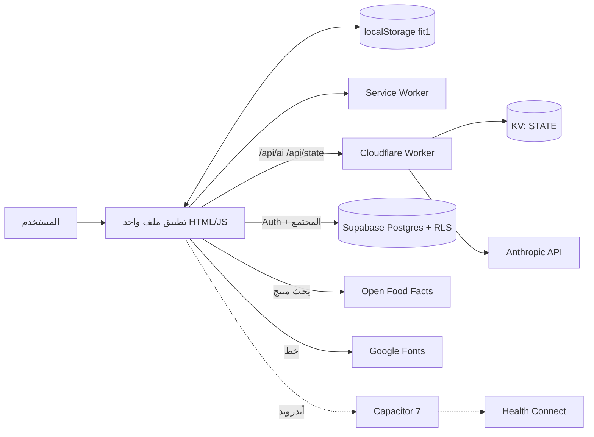
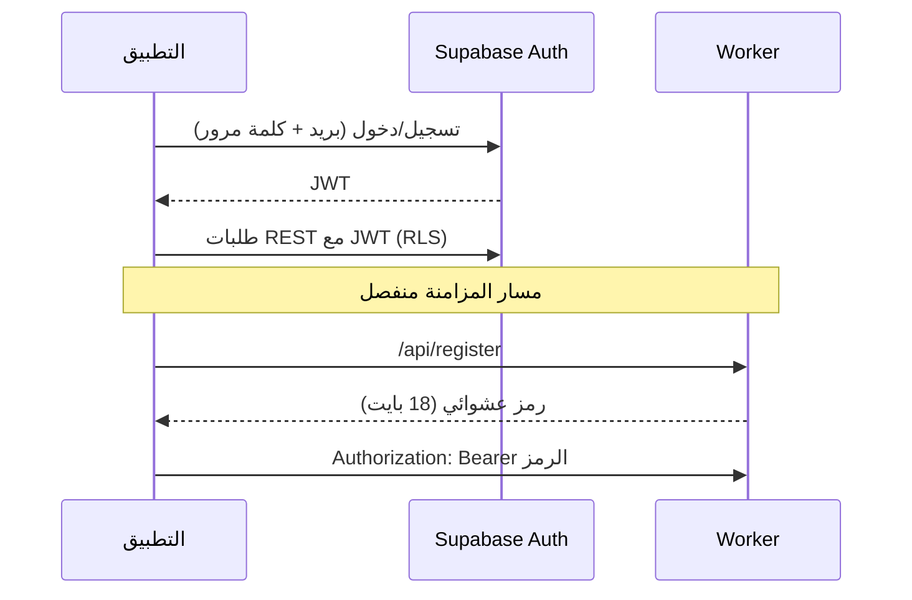
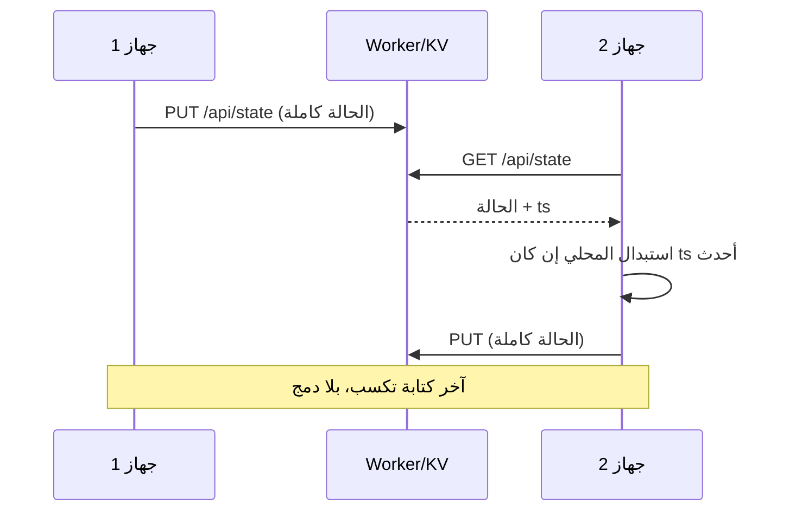
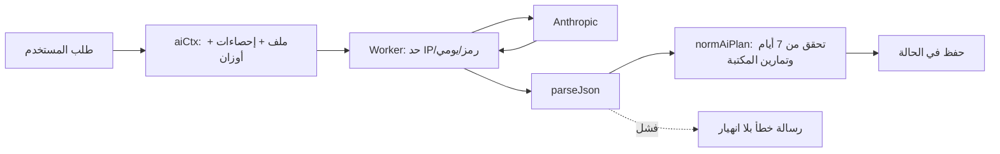
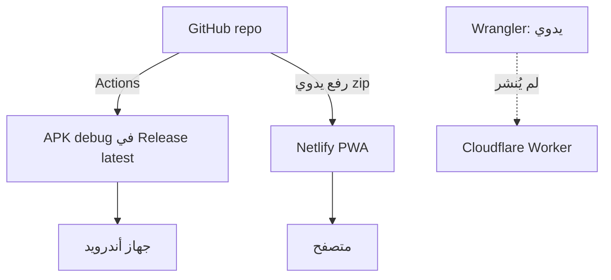

# 03 — تدقيق البنية

## البنية الحالية

## تدفق المصادقة

## تدفق المزامنة

## المعالجة بالذكاء الاصطناعي

## البنية الحالية للنشر

## الملاحظات
1. **نقطة قوة:** تخزين محلي أولًا، يعمل دون خادم؛ وسيط يخفي مفتاح الذكاء؛ RLS مختبر.
2. **ضعف:** ملف واحد يخلط بيانات ومنطقًا وواجهة (أسطر بيانات حتى 116 KB).
3. **ضعف:** `render()` يعيد بناء كل الـDOM؛ مقبول الآن (11 ms) لكنه يحد من الحركات وإمكانية الوصول (فقدان التركيز).
4. **ضعف:** حالة عامة `S` بلا طبقة وصول؛ كل وحدة تعدّلها مباشرة.
5. **ضعف:** نظامان للهوية (رمز الوسيط وحساب Supabase) بلا ربط.
6. **ضعف:** مشروع أندرويد مُولَّد في CI، فتعديلات الـmanifest تعتمد على سكربت patch هش.
