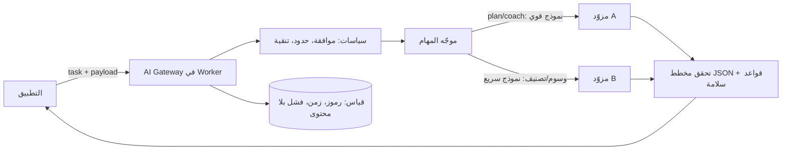

# 07 — نظام الذكاء الاصطناعي

## كيف يعمل
1. العميل يبني `aiCtx()` (ملف المستخدم، أهدافه، إحصاءات، أوزان حديثة، غذاء) ويرسله إلى `/api/ai` عبر `proxySample()`.
2. الوسيط يطبّق: أصل مسموح، حد لكل IP ولكل رمز وسقف يومي كلي (`AI_DAILY_CAP`=500)، صورة ≤2 MB، `max_tokens=1500`.
3. النموذج: `claude-sonnet-5-5` افتراضيًا و`claude-haiku-5-5` للمستوى `fast`.
4. العميل: `parseJson` ثم `normAiPlan` (يتطلب 7 أيام وتمارين موجودة في المكتبة؛ غير الموجودة تُستبعد).

## ما تحقق منه الاختبار
نجاح خطة (T07)، رد غير JSON (T08a)، فشل المزوّد (T08b)، تمارين خارج المكتبة (T08c): كلها بلا انهيار ورسالة خطأ واضحة. **كلها ضد مزوّد وهمي**؛ جودة المحتوى الفعلية لم تُقيَّم.

## المخاطر
| الخطر | الأثر | الإجراء |
|---|---|---|
| إرسال بيانات صحية إلى مزوّد خارجي | خصوصية | موافقة صريحة قبل أول استعمال + إفصاح (موجود بالسياسة) |
| توصيات غذاء/تمرين غير آمنة (حمية قاسية، أحمال عالية، حالات طبية) | سلامة | قواعد حدّية في الكود لا في النص فقط: حد أدنى للسعرات، حد أقصى لزيادة الحمل، إنكار طبي ثابت |
| حقن أوامر عبر حقول نصية (اسم، ملاحظات) | سلوك غير متوقع | فصل بيانات المستخدم داخل وسم/JSON واضح؛ المخرجات تُتحقق بمخطط |
| استنزاف التكلفة | مالي | سقف يومي موجود لكنه غير ذري؛ سقف لكل مستخدم يوميًا |
| الارتباط بمزوّد واحد | استمرارية | طبقة بوابة |
| لا تسجيل للاستعمال/الكلفة | عمى تشغيلي | عدّادات (طلبات، رموز، فشل) دون محتوى |

## مقترح AI Gateway (مستقل عن المزوّد)

- واجهة داخلية ثابتة: `task: plan|coach|food_vision|machine_vision`، ومخرجات مخطط JSON لكل مهمة.
- مزوّد مبدّل بمتغير بيئة؛ لا حاجة لخدمات مصغّرة، يبقى داخل Worker.
- ذاكرة تخزين (KV) لنتائج متطابقة قصيرة الأجل لتقليل التكلفة.
- تقدير تكلفة: خطة ≈ 2–4 آلاف رمز دخل و1.5 ألف خرج؛ تحتاج قياسًا فعليًا بعد النشر (لم يُقَس).
