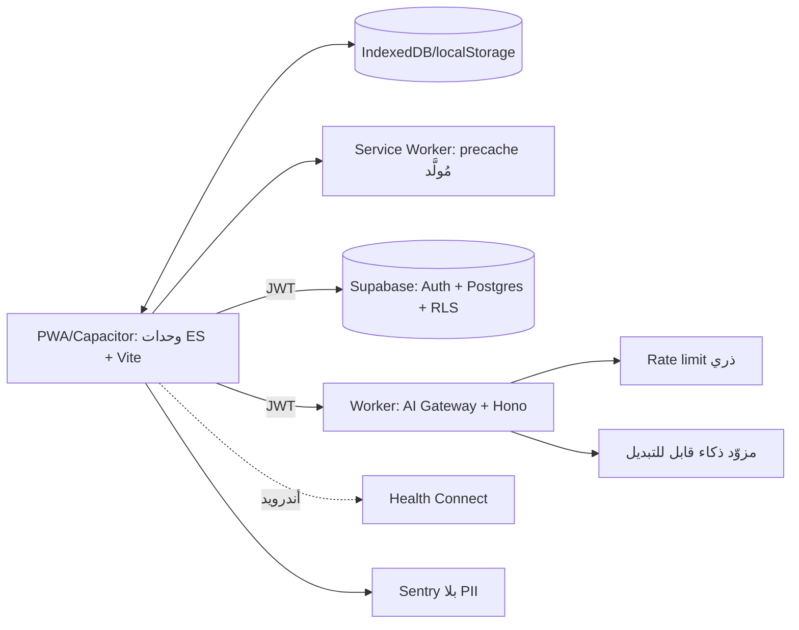
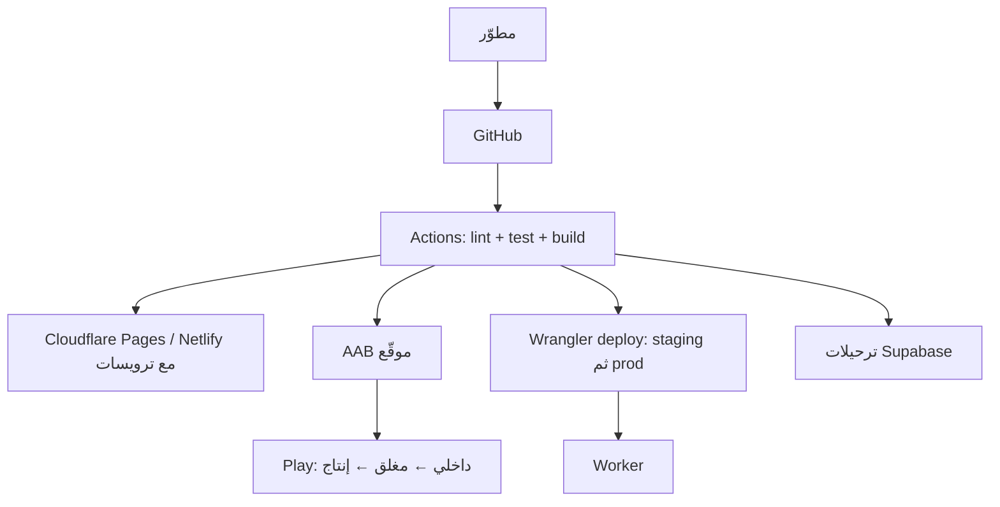

# 11 — البنية المستهدفة

المبدأ: **تطوير تدريجي، لا إعادة كتابة**. لا تقنية إلزامية؛ كل تغيير يحتاج دليلًا.

## القرارات
| الطبقة | الحالية | المقترحة | سبب القرار | التكلفة | أولوية التغيير |
|---|---|---|---|---|---|
| الواجهة | JS خام بملف واحد | البقاء مع تقسيم وحدات ES عبر Vite | يحسّن الصيانة دون تغيير السلوك | منخفضة (أيام) | متوسطة |
| لغة الكود | JS | `@ts-check` ثم TypeScript للوحدات الجديدة | أمان أنواع بلا ترحيل شامل | منخفضة | متوسطة |
| إطار واجهة | لا | **لا React الآن** | إعادة كتابة 39 شاشة بلا مكسب مثبت | مرتفعة | منخفضة |
| البناء | `build.py` | Vite | تجزئة وminify وhash للملفات | منخفضة | متوسطة |
| الكاش | `sw.js` يدوي | Workbox أو قائمة precache مُولَّدة | يحل T10c ويمنع نسيان الملفات | منخفضة | **عالية** |
| أندرويد | Capacitor 7 | Capacitor مع مجلد `android/` مُلتزَم به | يثبّت manifest ويلغي هشاشة patch | منخفضة | عالية |
| الوسيط | Worker خام | Hono على Workers | توجيه ومعالجة أخطاء أنظف | منخفضة | منخفضة |
| الحالة السحابية | KV (اللقطة كاملة) | Supabase Postgres (جداول + دمج) | يحل فقدان البيانات ويوحّد الهوية | منخفضة (طبقة مجانية) | **عالية** |
| الهوية | رمز وسيط + Supabase | Supabase Auth فقط (مجهول → حساب) | مصدر واحد للحقيقة، إبطال، حذف | منخفضة | عالية |
| تخزين الصور | لا (تُمرَّر للذكاء) | R2 عند الحاجة فقط | غير لازم الآن | — | WON'T |
| حدود المعدل | KV غير ذري | Rate Limiting binding / Durable Object | ذرية | منخفضة | متوسطة |
| الاختبار | Playwright + سكربتات | Vitest للمنطق + Playwright للتدفقات | تغطية سريعة | منخفضة | عالية |
| المراقبة | `ERRS` محلي | Sentry (بلا PII) | رؤية أعطال الإنتاج | $0–26/شهر | متوسطة |
| الذكاء | Anthropic مباشر | AI Gateway (07) | استقلال المزوّد وسلامة | حسب الاستعمال | متوسطة |

## البنية المستهدفة

## معمارية النشر المستهدفة

