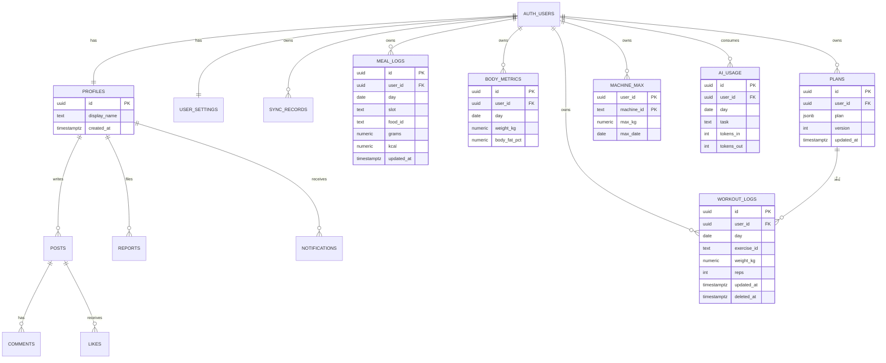

# 12 — تصميم قاعدة البيانات

الأساس: `supabase/schema.sql` (profiles، posts، comments، likes، reports، notifications، user_settings، قيود وحدود وRLS و`delete_my_account()`) مختبر محليًا. المقترح هنا **يضيف** جداول للمزامنة بدل لقطة KV الكاملة.

## ERD

## الجداول الجديدة المقترحة
| الجدول | المفتاح | فهارس | قيود | RLS |
|---|---|---|---|---|
| `workout_logs` | `id uuid` | `(user_id, day)`, `(user_id, updated_at)` | `weight_kg between 0 and 1000`، `reps between 0 and 1000` | `user_id = auth.uid()` لكل العمليات |
| `meal_logs` | `id` | `(user_id, day)` | `grams between 0 and 5000` | نفسه |
| `body_metrics` | `id`, unique `(user_id, day)` | | `weight_kg between 20 and 500`, `body_fat_pct between 2 and 70` | نفسه |
| `plans` | `id` | `(user_id)` | `jsonb_typeof(plan)='object'`، حجم ≤ 256 KB | نفسه |
| `machine_max` | `(user_id, machine_id)` | | `max_kg between 0 and 2000` | نفسه |
| `ai_usage` | `id` | `(user_id, day)` | | قراءة ذاتية، كتابة عبر دالة/Worker فقط |

## الدمج
كل صف يحمل `updated_at` و`deleted_at` (حذف ناعم). العميل يرسل الصفوف المتغيرة منذ آخر مزامنة؛ الخادم يقبل الأحدث لكل صف (LWW على مستوى الصف بدل المستند) فتُحفَظ تعديلات الجهازين المختلفة. تعارض الصف الواحد يُحَل بالأحدث.

## الترحيل
1. إبقاء `fit1` كما هو محليًا.
2. عند أول تسجيل دخول: رفع اللقطة المحلية إلى الجداول (خطوة أحادية الاتجاه مع نسخة JSON تُحفظ محليًا).
3. إيقاف `/api/state` بعد فترة تقاطع، ثم حذف مفاتيح KV.
4. ترحيلات SQL مرقّمة في `supabase/migrations/` تُطبَّق من CI.

## النسخ الاحتياطي والاستعادة
- Supabase: نسخ يومية (حسب الخطة)، وPITR في الخطة المدفوعة.
- `pg_dump` أسبوعي من CI إلى تخزين مشفّر خارجي.
- اختبار استعادة ربع سنوي إلى مشروع staging (لم يُجرَ حاليًا).
- المستخدم: تصدير JSON موجود (T11).
